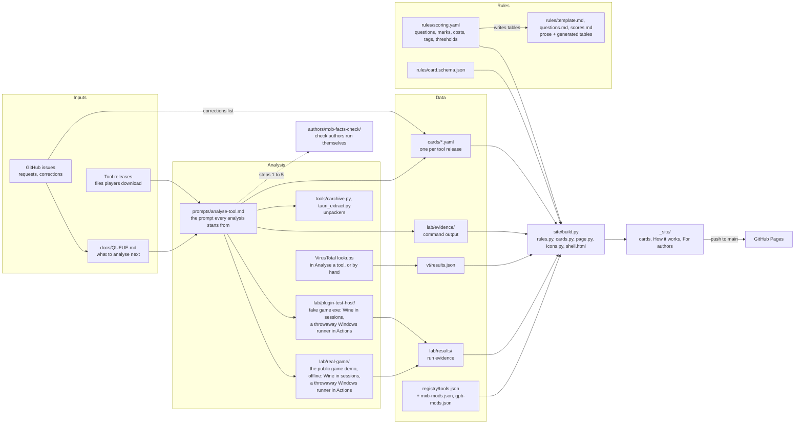

# Developing MXB Facts

How the pieces fit together and how the main jobs run. The rules themselves are in [`CLAUDE.md`](../CLAUDE.md) and [`rules/`](../rules/); this page links to them and doesn't restate them.

## The pieces

| Piece | What it does | Read more |
|---|---|---|
| `cards/<slug>-<version>.yaml` | One card per tool release: header, answers (verdict, mark, text, evidence), `areas` reasons, limits, corrections | `rules/card.schema.json`, `rules/template.md` |
| `rules/scoring.yaml` | The one place for every question, mark cell, cost, Money label, tag and threshold | its header comment |
| `rules/questions.md`, `rules/template.md`, `rules/scores.md` | Reader-facing explanation; their tables are written by the build from `scoring.yaml` | |
| `site/build.py` | Lists the cards (`CARDS`), runs the checks that need all of them, assembles and writes `_site/` | |
| `site/rules.py` | Loads and checks `rules/scoring.yaml` and the schema, writes the generated tables, and works out verdicts, marks, costs, scores, tags and the Money label; `STATES` says how each mark, state and result is shown (label, icon, meaning) | |
| `site/cards.py` | Checks one card (schema, every question answered, marks, evidence links, held-back rows) and works out what the rules set on it (its answers as lines, their costs, its key answers); loads the registry and `vt/results.json`. It makes no HTML | |
| `site/page.py` | All HTML, made from the checked card data (Markdown is only the text inside a field): tools list, tool pages, badges, How it works, For authors, and each tool's share address `<tool>/` (a small page with a link preview that opens the tool's page); it decides no mark or score | |
| `site/icons.py` | The Lucide icons (ISC licence) beside marks, states and results, as CSS masks and as SVG for the badges | |
| `prompts/analyse-tool.md` | The published prompt; changes to how we work change it in the same PR | |
| `lab/real-game/` | Runs plugins in the public MX Bikes or GP Bikes demo, offline, clicked through to a track (steps in `games.json`): under Wine + Xvfb in sessions (`run.sh`, the demo downloaded once into `cache/`), and on a throwaway Windows runner under Process Monitor in "Analyse a tool" (`windows/run.ps1`); the demo is pinned by SHA-256 | its README |
| `lab/plugin-test-host/` | Fake `mxbikes.exe` / `gpbikes.exe` that loads `.dlo` plugins: offline under Wine + Xvfb in sessions (`src/collect.sh` gathers evidence), and on a throwaway Windows runner under Process Monitor in "Analyse a tool" (`windows/run.ps1`) | its README, `windows/README.md` |
| `lab/evidence/` | The output of every command a card's lines name, one folder per card, written by its `run.sh` (helpers in `ev.sh`); the build refuses a line that names a command without linking its output | its README |
| `.claude/hooks/session-start.sh` | Cloud sessions: installs Wine, MinGW, Xvfb and builds the test host | |
| `tools/vt_lookup.py` + `virustotal.yml` | Hash lookups only; the "Analyse a tool" run makes the uploads (`tools/vt_release.py`; CLAUDE.md, "VirusTotal"). The workflow runs only when the maintainer starts it (`pr`=N comments on a PR; `tool` commits `vt/results.json`) | CONTRIBUTING, "VirusTotal" |
| `registry/` | Every tool and its cards; weekly snapshot of its mxb-mods.com / gpb-mods.com page and its newest release wherever it publishes (`inventory.yml`). Page text is a claim, used only for the says-vs-does questions | `registry/README.md` |
| `authors/mxb-facts-check/SKILL.md` | The check authors drop into their own repository (prompt steps 1 to 5 at a pinned commit) | |
| `docs/QUEUE.md` | Requested tools in request order, then the maintainer's picks, then "To revisit" | |
| `tools/check_links.py`, `check_corrections.py`, `issue_label.py`, `recheck_issues.py` | Pinned links exist; open correction issues are on their card; issues get a tool label; a newer release gets a re-check issue | |
| `tools/agent_run.py`, `check_plan.py` | Run one prompt with the Agent SDK (spending limit); check the plan for a Windows run before anything runs | |
| `.github/held-items.pem` | The maintainer's public key: a held item's report, and how a tool gets at protected content, leave the analysis job only encrypted to it (rule 9), each as its own draft advisory | `analyse.yml` header |
| `tests/test_build.py` | The build's own tests for scores, marks and tags | |

### Workflows on GitHub

| Workflow | When | Does |
|---|---|---|
| Check cards (`check.yml`) | Every PR and push to `main` (a newer push cancels the older run), when a draft PR is marked ready, and started by "Analyse a tool" on its PR | tests, build, link check, corrections check |
| Publish (`pages.yml`) | Push to `main` that changes a file the site is made from (not `lab/`, `tests/`, `docs/`, the other workflows or `registry/releases.json`), and after Update inventory or a VirusTotal lookup on `main` (their commits use the workflow's token, which starts no other workflow); also by hand | build, deploy `_site/` |
| VirusTotal lookup (`virustotal.yml`) | By hand only | lookups for a PR, one tool's cards (dropdown) or all cards; "Analyse a tool" makes its own |
| Analyse a tool (`analyse.yml`) | By hand only | On one tool from `registry/tools.json` (dropdown): a new card if it has none, else a re-check of its newest card, or only the questions it names (same release). With the version and release inputs empty, it first looks up the tool's latest GitHub release (`tools/releases_fetch.py --latest`), so a release out since the last Update inventory run needs no typing; a tool with no GitHub release takes the newest one in `registry/releases.json`. Every later job, the card and the PR use that one release. Claude (Agent SDK, `tools/agent_run.py`, `ANTHROPIC_API_KEY`) first plans the run from the licence and readme ($2 limit; nothing runs when the licence forbids analysis); a throwaway Windows runner with no keys runs the plugins in the real game (`lab/real-game/windows/`, the demo kept in the Actions cache) and the rest in the test host (`lab/plugin-test-host/windows/`); Claude then runs `prompts/analyse-tool.md` with that evidence ($10 limit) in a job that can only read the repository, and never runs the tool itself; a job downloads the release once (`tools/fetch_release.py`: plain https links, MEGA file links and files in MEGA folders) for the Windows runner and the lookups; VirusTotal hash lookups of the release files and what 7-Zip unpacks from them run beside the Windows run (`tools/vt_release.py`; the key only in the job that reads the hashes), which also uploads the downloaded files VirusTotal has no record of when the plan's licence read is `allows` and the `skip_upload` input is off, waiting up to 15 minutes for their scans (one not finished is recorded as pending), and the analysis answers P1 from them; a last job applies its changes, writes `vt/results.json` from the same lookups, opens a draft PR and starts Check cards on it. When an item must be held back (rule 9), there is no PR: its report is encrypted to `.github/held-items.pem` and filed as a private draft security advisory (`HELD_ITEMS_KEY`, `ADVISORY_TOKEN`) |
| Update inventory (`inventory.yml`) | Mondays, by hand | refreshes the mods-site snapshots and `registry/releases.json`; its summary lists tools with a release newer than their card, and it opens a "Re-check" issue for each (once) |
| Issues (`issues.yml`) | Issue opened, closed or reopened | labels a new issue by form and tool; runs the corrections check |

## Analysing a tool

1. Take the next tool from `docs/QUEUE.md` (requests first, in order).
2. Run [`prompts/analyse-tool.md`](../prompts/analyse-tool.md) with the tool's name, version and release link. It covers the licence check, hashes, method, the real-game and test-host runs, card writing and the held-back rule.
3. Run every `.dlo` in the real game (`lab/real-game/run.sh`, with a bare-demo baseline), then what the real game can't do on cue in the test host, and commit the evidence both gather under `lab/results/`, raw logs included (in "Analyse a tool", the Windows runner's evidence goes there instead). Run the commands the card's lines name from `lab/evidence/<card>/run.sh` and commit their output beside it.
4. Write `cards/<slug>-<version>.yaml`, add it to `CARDS` in `site/build.py` (alphabetical) and to `registry/tools.json`; run `python3 -I tools/mxbmods_fetch.py` if the tool has a mods-site page.
5. Run the checks below until they pass, open a PR, and ask the maintainer to run the VirusTotal workflow with `pr`=N. Fill P1 from its comment, linking each file's VirusTotal entry.

A newer release gets a new card file; the old one stays and is linked under "Earlier reports". The newest card is the tool's page (in the tools list, Compare and `<site>/<tool>/`); each earlier one keeps a page at `#<card file without .yaml>`, with a line pointing to the newest, and its badges.

## Building and checking

The commands are in [`CLAUDE.md`, "Checks before every push"](../CLAUDE.md#checks-before-every-push), with the tests in `tests/test_build.py`; CI runs the same ones. The build checks every card, writes `_site/` and the generated tables in `rules/`.

Never edit `_site/` or the generated tables in `rules/questions.md`, `rules/template.md` and `rules/scores.md`; edit `rules/scoring.yaml` or `rules/card.schema.json` and build again. CI fails while the tables are out of date.

## Changing a rule or a question

1. Edit `rules/scoring.yaml` (and the prose in `rules/template.md`, `questions.md` or `scores.md` if the explanation changes).
2. Run the build. It rewrites the tables, tells you which entries are missing (a cost and a tag for every Concern answer), and prints what the edit changes on each card compared with the last commit (`CHANGES_BASE` picks another; on a pull request CI uses its base branch). The build stops on a name used twice, or a Concern with no cost or no tag.
3. A new question: answer it on every card before publishing; the build refuses a card that misses one. A question that is removed or renamed can't linger: the build refuses any doc, form, the site's text or a card that still names it.
4. Add a case to `tests/test_build.py` when scores, marks or tags are set differently.
5. If the way an analysis runs changes, update `prompts/analyse-tool.md` and `authors/mxb-facts-check/SKILL.md` in the same PR.

## Handling a suggested question

It comes from the "Suggest a question" form, or from an analysis that found something no question asks. Decide it on a reason that holds for every tool. If it is taken, add it to `rules/scoring.yaml` (marks, cost, tags), answer it on every card in the same PR ("Not checked" where the existing evidence can't settle it), and close the issue with the decision. Details in `CLAUDE.md`, "Requests and corrections".

## Handling a correction

Add it to the card's `corrections` list (status `open`, its `kind` from the form: `correction`, `missing` or `context`, the questions it names); the comment icon on those answers then shows the count. When decided, fix the line if it holds and set the status (`fixed`, `declined`, or `noted` when it is answered without a change) with the date and a reason. Details in `CLAUDE.md`, "Requests and corrections".

## Where to change what

| To change | Edit |
|---|---|
| A question's wording, a mark cell, an area rule, a tag, the VirusTotal threshold | `rules/scoring.yaml` |
| How rules are explained to readers | prose in `rules/template.md`, `rules/questions.md`, `rules/scores.md` (not the tables) |
| The ten rules | `CLAUDE.md` and `rules/template.md` together; the build refuses the page when they differ |
| What a card may hold: its header rows, report sections, categories, verdicts | `rules/card.schema.json` |
| Page layout and styles | `site/shell.html`, `site/page.py` |
| How an analysis runs | `prompts/analyse-tool.md`, `authors/mxb-facts-check/SKILL.md`, `CLAUDE.md` "How to analyse" |
| What the test host does | `lab/plugin-test-host/src/` (extend it, don't start over) |
| Which game demo runs, and how the run reaches a track | `lab/real-game/games.json` |
| Which tools come next | `docs/QUEUE.md` |
| A tool's links or its list of cards | `registry/tools.json` |
